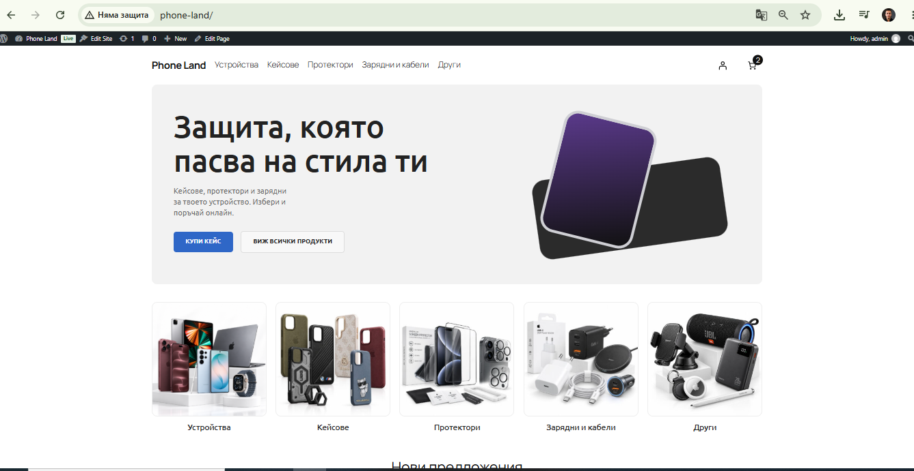
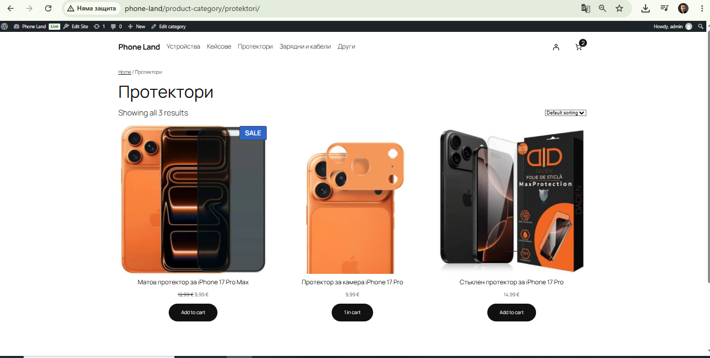
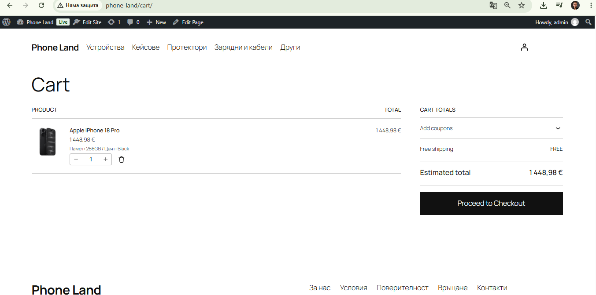

# Phone Land – WordPress E-commerce Practice

A local e-commerce website built with WordPress as a personal practice and portfolio project.

## Project Overview

Phone Land is a practice project focused on recreating the structure and visual layout of an online store specializing in mobile devices and accessories.

The website was developed in a local WordPress environment.

## Store Promotions

Free Shipping: Free shipping on orders over €1,000.
Welcome Discount: Get 10% off using the promo code WELCOME10.

## Screenshots

### Homepage

### Product Categories

### Cart Page

## Technologies

- WordPress
- Local development environment
- WooCommerce (if applicable)

## Features

- Homepage layout
- Navigation menu
- Product categories
- Product presentation
- E-commerce page structure

## Disclaimer

This is an independent, non-commercial practice project. Phone Land is a fictional project name and is not affiliated with any existing business.

The original website icase.bg was used as a visual reference. Some materials may belong to their respective owners.

This project is intended for portfolio and educational purposes only.
